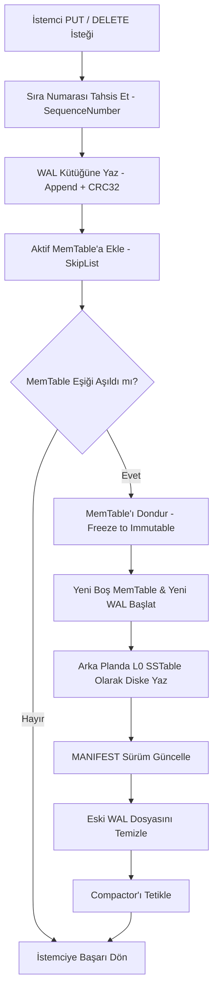
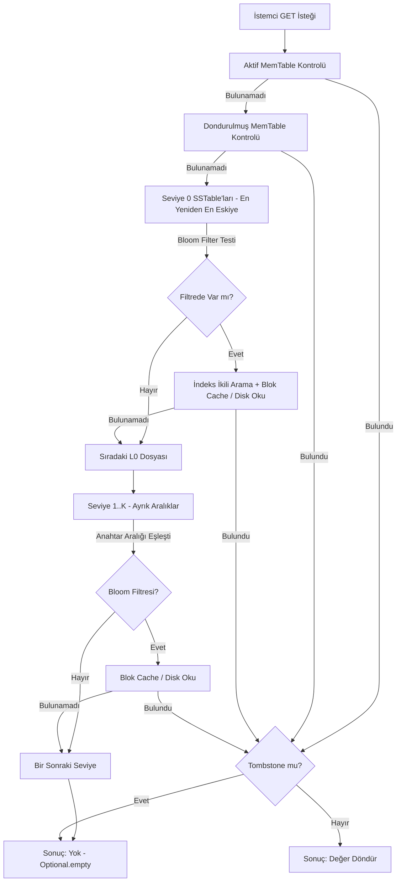

# Java LSM-Tree Depolama Motoru (Log-Structured Merge-Tree)

Java 21 Sanal İş Parçacıkları (Virtual Threads) ve Java NIO mimarisi üzerinde **sıfır harici bağımlılıkla** (zero-dependency pure Java) geliştirilmiş, yüksek yazma verimli, arıza toleranslı ve seviyeli birleştirmeli (Leveled Compaction) gömülü anahtar-değer (Key-Value) depolama motorudur.

LevelDB, RocksDB ve Cassandra mimarilerinin temel prensiplerini saf Java standart kütüphanesiyle hayata geçirerek; bellek içi atlama listesi (ConcurrentSkipListMap), CRC32 sağlama toplamlı Write-Ahead Log (WAL), ikili (binary) SSTable blokları, Kirsch-Mitzenmacher çift hashlemeli Bloom Filtresi ve arka plan Seviyeli Birleştirici (Leveled Compactor) bileşenlerini barındırır.

```
+-----------------------------------------------------------------------------------+
|                                İstemci Uygulama                                    |
+-----------------------------------------+-----------------------------------------+
                                          |
                               [PUT / GET / DEL / SCAN]
                                          v
+-----------------------------------------------------------------------------------+
|                                    LsmEngine                                      |
|                                                                                   |
|  +-----------------------+     +-----------------------+     +-----------------+  |
|  |    Write-Ahead Log    | <-- |     Aktif MemTable    |     |  Blok Önbellek  |  |
|  |     (WAL + CRC32)     |     |  (ConcurrentSkipList) |     |   (LRU Cache)   |  |
|  +-----------------------+     +-----------+-----------+     +--------+--------+  |
|                                            |                          ^           |
|                                  (Bellek Eşiği / Flush)               |           |
|                                            v                          |           |
|                                +-----------------------+              |           |
|                                |   Dondurulmuş MemTable|              |           |
|                                |  (Immutable Snapshot) |              |           |
|                                +-----------+-----------+              |           |
+--------------------------------------------|--------------------------|-----------+
                                             v                          |
+-----------------------------------------------------------------------|-----------+
|                          Disk Katmanı & MANIFEST Sürüm Yönetimi       |           |
|                                                                       |           |
|  [Seviye 0 (L0)]  -->  [ table-01.sst ]  [ table-02.sst ]             |           |
|       |                                                               |           |
|  (Compaction)                                                         |           |
|       v                                                               |           |
|  [Seviye 1 (L1)]  -->  [ key: a-m.sst ]  [ key: n-z.sst ] ------------+           |
|       |                                                                           |
|  (Compaction)                                                                     |
|       v                                                                           |
|  [Seviye 2 (L2)]  -->  [ key: aa-dd.sst ] ... [ key: ww-zz.sst ]                  |
+-----------------------------------------------------------------------------------+
```

---

## Temel Özellikler

- **Saf Java 21 & Sıfır Bağımlılık**: Maven veya üçüncü parti kütüphane bağımlılığı olmaksızın sadece `javac` ile derlenebilir.
- **Yüksek Yazma Başarımı (Write Throughput)**: Tüm yazma işlemleri sıralı disk G/Ç (sequential I/O) ile WAL kütüğüne yazılır ve bellek içi MemTable'a eklenir; disk arama (disk seek) maliyeti yoktur.
- **Çökme Direnci ve Dayanıklılık (Crash Resilience & WAL)**: Elektrik kesintisi veya ani çökmelerde CRC32 ile doğrulanmış WAL loglarından otomatik kurtarma (recovery).
- **$O(1)$ Negatif Arama Bypass'ı (Bloom Filter)**: Kirsch-Mitzenmacher çift hashleme algoritmasıyla disk G/Ç maliyetini %99'a varan oranda düşüren Bloom filtreleme.
- **Blok Tabanlı İkili SSTable Formatı**: 4 KB / 8 KB bloklar, seyrek blok indeksi (Sparse Index) ve dosya sonunda 48 baytlık sabit Footer.
- **LRU Blok Önbelleği (Block Cache)**: En son erişilen veri bloklarını bellekte tutarak tekrarlayan noktasal okumalarda mikrosaniye altı yanıt süresi.
- **Seviyeli Birleştirme (Leveled Compaction)**: Arka planda çalışan Sanal İş Parçacığı (Virtual Thread) ile çakışan anahtarları birleştirme, mezar taşlarını (tombstones) temizleme ve okuma yükseltmesini (Read Amplification) denetim altında tutma.
- **Aralık Taraması (Range Scan & MergingIterator)**: Min-Heap (K-Way Merge) üzerinden birden fazla SSTable ve MemTable'ı tek bir sıralı akışta birleştiren yineleyici.

---

## Mimari Tasarım ve Veri Akışı

### 1. Yazma Yolu (Write Path)

LSM-Tree'de veriler doğrudan disk bloklarının üzerine yazılmaz (no in-place updates). Her işlem eklemelidir (append-only):



### 2. Okuma Yolu (Read Path)

Bir anahtar sorgulandığında (`get`), verinin en güncel hali aranır. Sorgulama katmanları en güncelden en eskiye doğru sırayla taranır:



---

## SSTable İkili (Binary) Dosya Formatı

Motorun ürettiği her `.sst` dosyası, disk blok verimliliği ve hızlı ikili arama için tasarlanmıştır:

```
+-----------------------------------------------------------+
| VERİ BLOĞU 0 (Data Block 0) - ~4 KB                       |
|   [Type: 1B] [KeyLen: 4B] [Key] [ValLen: 4B] [Val] ...    |
+-----------------------------------------------------------+
| VERİ BLOĞU 1 (Data Block 1)                               |
|   ...                                                     |
+-----------------------------------------------------------+
| ... VERİ BLOĞU N                                          |
+-----------------------------------------------------------+
| SEYREK İNDEKS BLOĞU (Sparse Index Block)                  |
|   Blok Sayısı: [int: 4B]                                  |
|   Her Blok İçin: [FirstKey] [LastKey] [Offset: 8B] [Len]  |
+-----------------------------------------------------------+
| BLOOM FİLTRESİ BLOĞU (Bloom Filter Block)                 |
|   [k: 4B] [m: 4B] [WordCount: 4B] [BitSet Words: N*8B]    |
+-----------------------------------------------------------+
| ALTBİLGİ - FOOTER (Sabit 48 Bayt - Dosya Sonu)            |
|   IndexOffset        : 8 Bayt (long)                      |
|   IndexLength        : 4 Bayt (int)                       |
|   FilterOffset       : 8 Bayt (long)                      |
|   FilterLength       : 4 Bayt (int)                       |
|   MinSequenceNumber  : 8 Bayt (long)                      |
|   MaxSequenceNumber  : 8 Bayt (long)                      |
|   RecordCount        : 4 Bayt (int)                       |
|   Sihirli Numara     : 4 Bayt (0x4C534D31 = "LSM1")       |
+-----------------------------------------------------------+
```

---

## Matematiksel Modeller

### 1. Bloom Filtresi Boyut ve Hash Optimizasyonu

Beklenen eleman sayısı $n$ ve hedeflenen yanlış pozitif hata payı $p$ verildiğinde, gerekli asgari bit sayısı ($m$) ve optimum bağımsız hash fonksiyonu sayısı ($k$) şu formüllerle hesaplanır:

$$m = -\frac{n \ln p}{(\ln 2)^2}$$

$$k = \frac{m}{n} \ln 2$$

Kirsch ve Mitzenmacher teoremine göre, $k$ adet bağımsız hash fonksiyonu çalıştırmak yerine 2 adet 64-bit bağımsız hash ($h_1, h_2$) üretilerek $i$. hash şu şekilde hesaplanır:

$$g_i(x) = (h_1(x) + i \cdot h_2(x)) \pmod m$$

Bu yöntem hesaplama karmaşıklığını $O(k)$'dan $O(1)$'e indirir.

### 2. Seviyeli Birleştirme (Leveled Compaction) Sınırları

Her seviyenin kapasitesi katlanarak büyür ($T = 10$ büyüme faktörü):

$$\text{Boyut}(L_i) = \text{Boyut}(L_1) \cdot T^{i-1}$$

Maksimum seviye sayısı $L$ olduğunda:
- **Okuma Yükseltmesi (Read Amplification)**: En kötü senaryoda $O(L)$ dosya taranır. Bloom Filtresi sayesinde ortalama $O(1)$ seviyesindedir.
- **Yazma Yükseltmesi (Write Amplification)**: Ortalama $O(T \cdot L)$ mertebesindedir.
- **Alan Yükseltmesi (Space Amplification)**: Seviyeli stratejide geçersiz veri oranı genelde $\%10$'un altındadır.

---

## Proje Dizin Yapısı

```
java_lsm_tree_storage_engine/
├── build.sh                 # Pure javac derleme betiği
├── test.sh                  # Kapsamlı test koşucu betiği
├── benchmark.sh             # Sanal iş parçacıklı kıyaslama betiği
├── cli.sh                   # İnteraktif REPL kabuğu
├── demo.sh                  # Hızlı mimari demonstrasyon betiği
├── LICENSE                  # MIT Lisansı
├── README.md                # Teknik mimari ve dokümantasyon
└── src/
    ├── main/java/dev/lsm/
    │   ├── Main.java                        # Ana giriş ve yönlendirici
    │   ├── model/
    │   │   ├── ByteUtils.java               # Bayt sıralama ve MurmurHash3
    │   │   ├── Entry.java                   # Kullanıcı seviyesi KV kaydı
    │   │   ├── KeyValueRecord.java          # Dahili sürüm ve mezar taşı modeli
    │   │   └── RecordType.java              # PUT ve DELETE (Tombstone)
    │   ├── filter/
    │   │   └── BloomFilter.java             # Kirsch-Mitzenmacher Bloom Filtresi
    │   ├── wal/
    │   │   ├── WalWriter.java               # CRC32 destekli append-only yazıcı
    │   │   ├── WalReader.java               # Çökme kurtarma ve CRC doğrulayıcı
    │   │   └── WalManager.java              # WAL rotasyonu ve temizleme
    │   ├── memtable/
    │   │   ├── MemTable.java                # ConcurrentSkipList bellek tablosu
    │   │   └── MemTableSnapshot.java        # Dondurulmuş değiştirilemez anlık görüntü
    │   ├── sstable/
    │   │   ├── BlockMeta.java               # Blok seyrek indeks kaydı
    │   │   ├── Footer.java                  # 48 baytlık sabit SSTable altbilgisi
    │   │   ├── BlockCache.java              # LRU blok önbelleği
    │   │   ├── SSTableWriter.java           # İkili blok ve indeks yazıcısı
    │   │   ├── SSTableReader.java           # İkili arama ve önbellekli okuyucu
    │   │   └── SSTableIterator.java         # Blok akış yineleyicisi
    │   ├── manifest/
    │   │   ├── FileMetaData.java            # SSTable seviye ve aralık meta verisi
    │   │   ├── VersionEdit.java             # Atomik sürüm geçiş paketi
    │   │   ├── Version.java                 # Seviye anlık görüntüsü ve referans sayımı
    │   │   └── ManifestManager.java         # MANIFEST kütüğü ve kurtarma
    │   ├── compaction/
    │   │   ├── CompactionTask.java          # Birleştirme görevi modeli
    │   │   ├── CompactionStrategy.java      # Seviyeli birleştirme karar motoru
    │   │   ├── MergingIterator.java         # K-Way Min-Heap birleştirici
    │   │   └── Compactor.java               # Sanal iş parçacıklı birleştirici işçi
    │   ├── engine/
    │   │   ├── LsmConfig.java               # Konfigürasyon ayarları ve builder
    │   │   ├── EngineStats.java             # Telemetri ve metrikler
    │   │   └── LsmEngine.java               # Motor ana koordinatörü ve genel API
    │   └── cli/
    │       ├── LsmRepl.java                 # ANSI renkli interaktif kabuk
    │       └── LsmBenchmark.java            # Çok iş parçacıklı kıyaslama aracı
    └── test/java/dev/lsm/
        ├── LsmTestSuite.java                # 9 adet kapsamlı birim/entegrasyon testi
        └── TestRunner.java                  # Bağımsız saf Java test koşucusu
```

---

## Kurulum ve Çalıştırma

### Gereksinimler
- **Java Development Kit (JDK) 21** veya üzeri (Virtual Threads desteği için).

### 1. Derleme (Build)
```bash
./build.sh
```

### 2. Testleri Çalıştırma
Tüm motor bileşenlerini doğrulayan 9 adımlı test paketini yürütür:
```bash
./test.sh
```

### 3. Mimari Demonstrasyonunu Çalıştırma
```bash
./demo.sh
```

### 4. İnteraktif REPL Kabuğu (CLI)
```bash
./cli.sh
```
Komut örnekleri:
```text
lsm-kv> put user:1001 {"name":"Kayra","role":"Engineer"}
OK: user:1001 kaydedildi.

lsm-kv> get user:1001
{"name":"Kayra","role":"Engineer"}

lsm-kv> scan user:1000 user:2000
--- Tarama Sonuçları ---
  user:1001 -> {"name":"Kayra","role":"Engineer"}

lsm-kv> flush
✓ MemTable diske (SSTable L0) boşaltıldı (12 ms)

lsm-kv> stats
=== LSM Engine İstatistikleri ===
Yazma (PUT): 1 | Okuma (GET): 1 | Silme (DEL): 0
...
```

### 5. Sanal İş Parçacıklı Performans Kıyaslaması (Benchmark)
```bash
./benchmark.sh
```

---

## Java Kodunda Kullanım Örneği

```java
import dev.lsm.engine.LsmConfig;
import dev.lsm.engine.LsmEngine;
import dev.lsm.model.ByteUtils;
import dev.lsm.model.Entry;

import java.nio.file.Paths;
import java.util.Iterator;
import java.util.Optional;

public class Example {
    public static void main(String[] args) throws Exception {
        LsmConfig config = LsmConfig.builder()
                .dbPath(Paths.get("./data/my_lsm_db"))
                .memTableThresholdBytes(4 * 1024 * 1024L) // 4 MB
                .targetBlockSize(4096)                    // 4 KB Bloklar
                .bloomFpp(0.01)                           // %1 False Positive Oranı
                .build();

        try (LsmEngine engine = LsmEngine.open(config)) {
            // Veri Ekleme (PUT)
            engine.put("device:sensors:temp", "24.5C");
            engine.put("device:sensors:humidity", "48%");

            // Veri Okuma (GET)
            Optional<String> temp = engine.get("device:sensors:temp");
            temp.ifPresent(v -> System.out.println("Sıcaklık: " + v));

            // Aralık Taraması (Range Scan)
            Iterator<Entry> it = engine.scan(
                    ByteUtils.toBytes("device:sensors:a"),
                    ByteUtils.toBytes("device:sensors:z")
            );
            while (it.hasNext()) {
                Entry entry = it.next();
                System.out.println(entry.keyAsString() + " => " + entry.valueAsString());
            }

            // Veri Silme (Tombstone)
            engine.delete("device:sensors:temp");

            // Elle Flush ve Compaction Tetikleme
            engine.flush();
            engine.compact();
        }
    }
}
```

---

## Lisans

Bu proje [MIT Lisansı](LICENSE) altında yayımlanmıştır. Telif hakkı (c) 2026 Kaayra.
